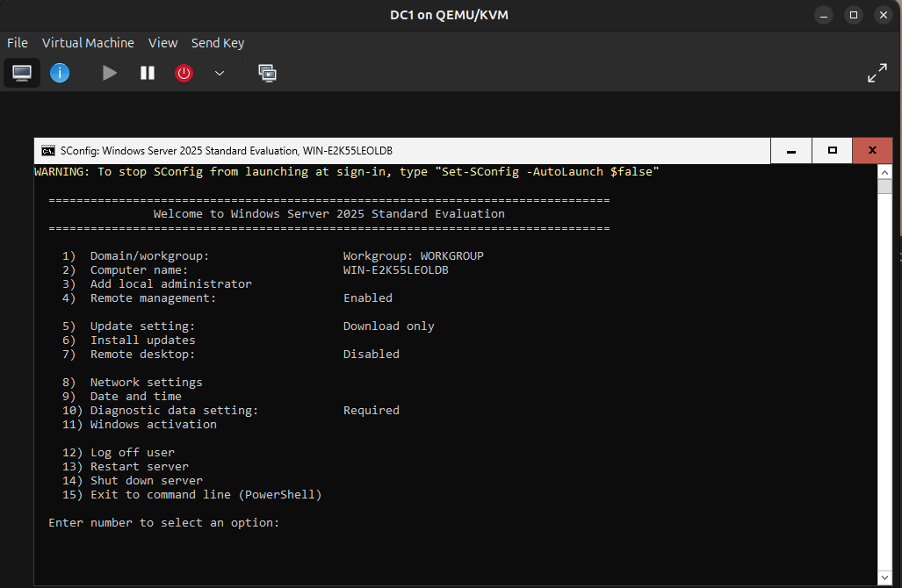

# 01 – Host Setup

Turning the Ubuntu host into a KVM hypervisor so it can run the lab's virtual machines.

For the initial setup, I followed [this Ubuntu guide](https://ubuntu.com/blog/kvm-hyphervisor).

## 1. Verify hardware virtualization support

Before installing anything, I confirmed the CPU supports hardware virtualization and that it's enabled in the BIOS:

```bash
sudo apt install -y cpu-checker
kvm-ok
```

## 2. Install KVM and management tools

```bash
sudo apt update
sudo apt install -y qemu-kvm libvirt-daemon-system libvirt-clients bridge-utils virtinst virt-manager
```

| Package | Purpose |
|---|---|
| `qemu-kvm` | The hypervisor that runs the VMs |
| `libvirt-daemon-system` | The libvirt service that manages VMs |
| `libvirt-clients` | Command-line tools such as `virsh` |
| `bridge-utils` | Tools for creating network bridges |
| `virtinst` | `virt-install`, for creating VMs from the command line |
| `virt-manager` | Graphical interface for managing VMs |

## 3. Start and enable the libvirt service

This starts the virtualization service now and sets it to launch automatically on boot:

```bash
sudo systemctl enable --now libvirtd
```

I confirmed the service was running:

```bash
systemctl status libvirtd --no-pager -l
```

```text
● libvirtd.service - libvirt legacy monolithic daemon
     Active: active (running) since Sun 2026-10-11 16:33:29 EDT; 1h 12min ago
...
Oct 11 17:21:21 PEACHEY dnsmasq-dhcp[1738]: DHCPDISCOVER(virbr0) 52:54:00:e6:0d...
Oct 11 17:21:21 PEACHEY dnsmasq-dhcp[1738]: DHCPOFFER(virbr0) 192.168.122.118 ...
Oct 11 17:21:21 PEACHEY dnsmasq-dhcp[1738]: DHCPREQUEST(virbr0) 192.168.122.118 ...
Oct 11 17:21:21 PEACHEY dnsmasq-dhcp[1738]: DHCPACK(virbr0) 192.168.122.118 ...
```

`active (running)` confirms the service is up. The DHCP lines show a VM requesting and receiving an IP address from libvirt's built-in DHCP server on the default NAT network (`virbr0`), which confirms that virtual networking works.

## 4. Grant my user access to libvirt

Adding my user to the `libvirt` group lets me manage VMs without `sudo`:

```bash
sudo usermod -aG libvirt $USER
```

Group membership only takes effect after logging out and back in (see the issue below). After re-logging, I verified it:

```bash
groups
```

## 5. Launch virt-manager

```bash
virt-manager
```

### Issue: virt-manager couldn't connect to libvirt

The first time I opened virt-manager, it failed with:

```text
Unable to connect to libvirt.
Verify that the 'libvirtd' daemon is running.
```

The daemon *was* running, so that wasn't the problem. [This Ask Ubuntu thread](https://askubuntu.com/questions/345218/virt-manager-cant-connect-to-libvirt) pointed to the cause: I had added myself to the `libvirt` group but hadn't logged out. Linux reads group memberships only at login, and every app opened afterward inherits the group list from that session, so my session didn't have the `libvirt` group yet. Logging out and back in fixed it.

## 6. Test VM: Windows Server 2025

To confirm everything worked end to end, I created a VM from the [Windows Server 2025 evaluation ISO](https://www.microsoft.com/en-us/evalcenter/download-windows-server-2025).

| Setting | Value |
|---|---|
| vCPUs | 2 |
| RAM | 4gb |
| Disk size | 60gb |

The VM booted and Windows Server installed successfully, and it received an IP address on the default network (see the DHCP lines in step 3).


